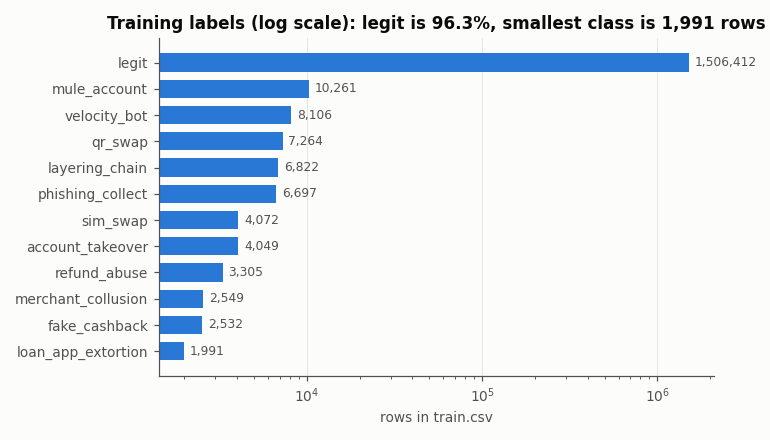
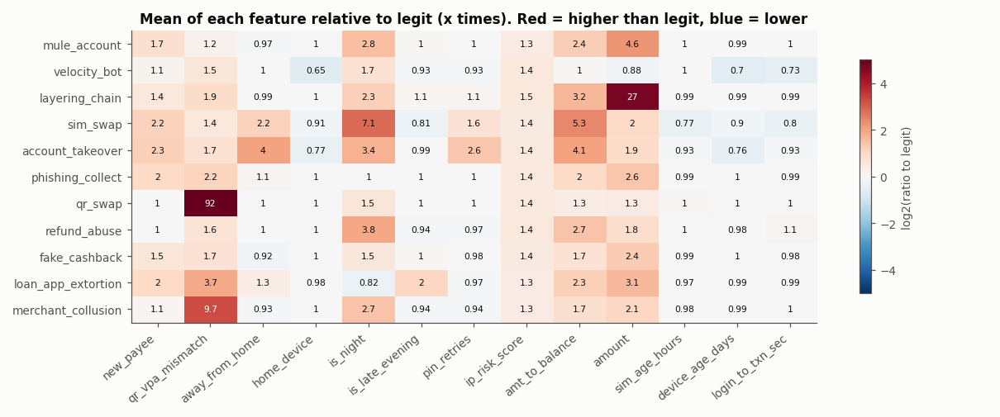
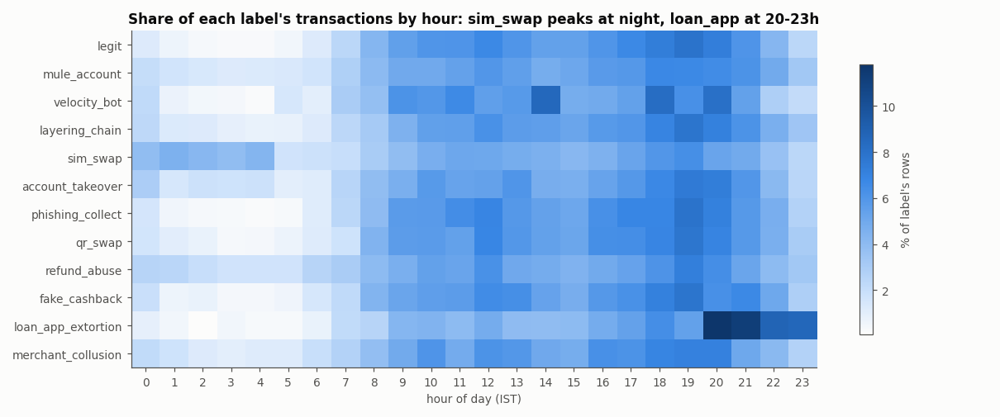
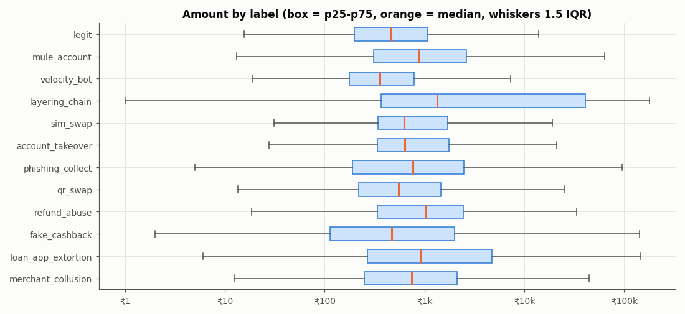
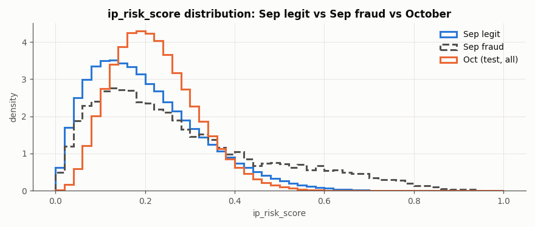
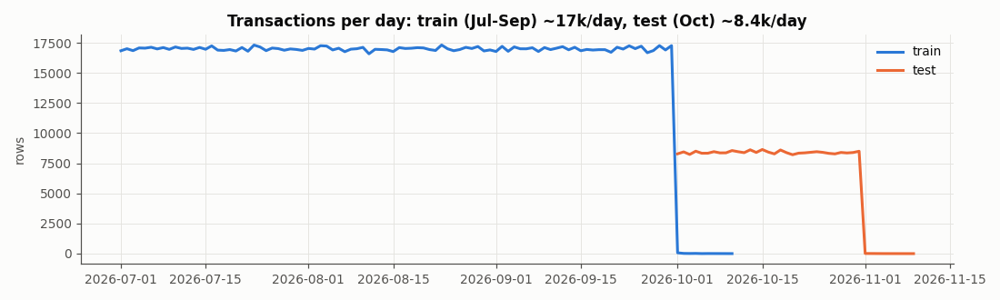
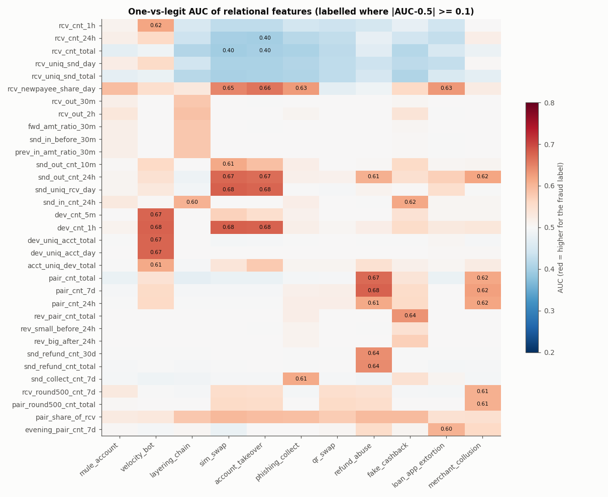

# UPI Fraud Rings: exploratory data analysis

ML Gradient Wars 2026 · analysed 2026-11-13 (round day 1) · data: `data/raw/*.csv` from `upi-fraud-rings-gradient-wars.zip`

Every number in this report comes from the scripts in [scripts/eda/](../../scripts/eda/). Their raw outputs are in [tables/](tables/). Validation is always **train Jul–Aug → score September**, which is the closest stand-in for "train Jul–Sep → predict October".

---

## TL;DR: what drives the modelling plan

1. **This is a needle-in-a-haystack, 12-way macro-F1 problem.** Fraud is 3.69% of rows. Each fraud class is 0.13–0.66% of rows (1,991–10,261 training rows). `legit` counts for 1/12 of the score, the same as each fraud type.
2. **Two columns are traps. Drop them.**
   - `app_version`: train has only 3.x/4.x and test has only 5.0/5.1/5.2, with no overlap. In train, 3.x makes up 30–34% of *every* fraud class against 15% of legit, so a model learns "old app = fraud", and that rule can't fire in October.
   - `ip_risk_score`: in Jul–Sep, 13–18% of fraud rows score > 0.5 against 2% of legit. In October the 99th percentile is 0.47, so the tail that carried the signal is gone (PSI 0.28; the top drift feature in adversarial validation).
3. **Each fraud type has about 25% "on-pattern" rows and about 75% "off-pattern" rows.** On-pattern rows have a crisp signature (e.g. 100% integer amounts, ~90% new payee, sharp SIM/device/forwarding patterns). Off-pattern rows look like legit, and **0–1.6% of them link to an on-pattern row of the same type** through sender, receiver, device or money flow. Most of them look undetectable, which explains the organisers' "0.40 is excellent". A perfect detector of my signature rows scores **0.454** macro-F1 on September (§9). LightGBM already finds a few more rows than the signatures for `layering_chain`, `phishing_collect` and `qr_swap`, so treat 0.454 as a soft ceiling.
4. **The signal is relational, not in single rows.** Single-row columns barely differ between labels; the best row-level fraud-vs-legit AUC is 0.62 (`amount is a whole number`). Cross-row features (receiver bursts, money forwarded within 30 min, device bursts, reverse-direction pairs, repeat refunds, round-number pair repeats) reach 47–82% precision per type (§8).
5. **Fraud events are tight, clean clusters.** P2P rows paid to a receiver within ±1h of a `mule_account` row are 95% `mule_account`. Rows from a device within ±5 min of a `velocity_bot` row are 94% `velocity_bot`. Event-level aggregation and label propagation will pay off.
6. **October drift is real but specific:**
   - Amounts are 10–21% higher in every category (festival season), so absolute amount cut-offs shift. Round-number, ratio and "just under ₹x,000" features stay stable.
   - Most fraud signatures fire at the same rate in October as in September.
   - **`velocity_bot` and `loan_app_extortion` changed shape.** Device bursts (≥3 payments in 5 min) fall from 0.22% to 0.11% of rows, and repeated late-evening pair payments from 0.50% to 0.30%. Use wider windows and rate-free features for those two.
7. **Test is less dense than train.** October has 8.4k rows/day against about 17k/day in Jul–Sep, with 1.76 rows per sender against 2.37. Pair-based fraud markers per row are unchanged, so the test month looks like a smaller population rather than a random row sample. Raw count features still shift downward, so prefer ratios, ranks and "≥ k" flags that are robust to density.
8. **Training labels are mostly clean inside events.** About 4–5% of rows inside a mule or bot burst are labelled `legit` (likely unreported fraud). About 25% of REFUND claims by known refund abusers are `legit`. Most multi-label entities are victim coincidence or cash-out accounts reused across schemes, not mislabelling (§10).
9. **Baselines (Sep validation):**
   - Hand-written rules only: **0.392**.
   - LightGBM on single-row features (traps removed): **0.339**.
   - The same model plus relational features: **0.391**.
   - Rules and model win on *different* classes. Taking the better of the two per class gives about **0.426**, so combine them.
   - The trap columns add +0.011 on September, but in October they no longer mark fraud at all (§5), so that gain is illusory.
10. **A rules-only submission** (`submissions/rules_v0.csv`) is ready as a safe first upload.

---

## 1. Files and structure

| File | Rows | Notes |
|---|---|---|
| `train.csv` | 1,564,060 | 22 columns, 1 Jul → 10 Oct 2026. The 147 October rows are tails of September events (74 are `refund_abuse`). |
| `test.csv` | 260,582 | 21 columns, 1 Oct → 9 Nov 2026. The 46 November rows are tails of October events. |
| `accounts.csv` | 420,000 | home_city, bank_code (30), kyc_level (full/min), opened_on (2015-07 → 2026-06), os |
| `merchants.csv` | 30,000 | category (12), city (40), onboarded_on |
| `sample_submission.csv` | 260,582 | same ids, same order as test; all `legit` |

Integrity checks all pass:
- No duplicate `txn_id`s, and train and test ids don't overlap.
- Every sender is in `accounts`. `AC…` receivers are always P2P and in `accounts`; `MR…` receivers are always MERCHANT and in `merchants`.

Structure worth knowing:
- `device_id == "DV0" + sender digits` for 91.9% of rows (the account's **home phone**). The other 8.1% are another phone, either shared or new.
- `merchant_category` on a transaction always equals the merchant's own category, so the column is redundant with `merchants.csv`. Merchant city matches device city only 1.5% of the time; this is synthetic noise with no signal.
- `qr_vpa_mismatch` is filled in for 99.9% of `QR` rows and is blank for almost everything else (64% blank overall).
- Entity overlap: 91.5% of test senders, 79.3% of test receivers and 86.9% of test devices also appear in train.
- Pandas memory: train about 1.2 GB, test 0.2 GB. Everything fits on a 16 GB laptop.

## 2. Labels

| label | train rows | % of rows | % of fraud |
|---|---:|---:|---:|
| legit | 1,506,412 | 96.31 | – |
| mule_account | 10,261 | 0.656 | 17.8 |
| velocity_bot | 8,106 | 0.518 | 14.1 |
| qr_swap | 7,264 | 0.464 | 12.6 |
| layering_chain | 6,822 | 0.436 | 11.8 |
| phishing_collect | 6,697 | 0.428 | 11.6 |
| sim_swap | 4,072 | 0.260 | 7.1 |
| account_takeover | 4,049 | 0.259 | 7.0 |
| refund_abuse | 3,305 | 0.211 | 5.7 |
| merchant_collusion | 2,549 | 0.163 | 4.4 |
| fake_cashback | 2,532 | 0.162 | 4.4 |
| loan_app_extortion | 1,991 | 0.127 | 3.5 |

The mix is stable month to month: every class is within ±0.03 percentage points across Jul, Aug and Sep. There are 520–750 fraud rows per day.

## 3. Single-row features by label

Most columns look the same for every label: median sender account age, balance, kyc, os, bank, home city and app brand are all near-identical. The fraud rate by device city ranges only 3.4–4.2%, and by bank 3.5–4.0%. The row-level differences that do exist:

| label | what differs from legit (train) |
|---|---|
| sim_swap | SIM changed recently: 25th percentile of `sim_age_hours` is **64h** (legit 5th percentile: 423h). **22.5% at night (0–5h)** vs 3.2%. 15.6% had a PIN retry vs 10%. 15% away from home vs 7%. 50% new payee vs 23%. |
| account_takeover | New device: 25th percentile of `device_age_days` is **8.9** (legit 5th percentile: 15.2). 27% away from home vs 7%. **23.5% PIN retries** vs 10%. 29% not on the home phone. 52% new payee. |
| velocity_bot | **40% not on the home phone** (vs 8%). Fast taps: `login_to_txn_sec` 25th percentile is 5s (legit 24s). 74% merchant payments; ecommerce 39% and gaming 6% of rows. |
| phishing_collect | **27% COLLECT** vs 3.2%. Amounts sit just under a round number (see §4). 45% new payee. |
| qr_swap | 55% QR vs 36%. **`qr_vpa_mismatch=1` in 30% of its non-blank rows** (legit 0.3%). Paid to P2P accounts even when the type is QR. |
| refund_abuse | **29% REFUND** vs 0.7%. Ecommerce 32% and electronics 8% of rows. |
| loan_app_extortion | **40% at 20–23h** vs 20%. **24% to `lending` merchants** vs 0.9%. |
| fake_cashback | 13% COLLECT. ₹1–₹10 amounts in 17% of rows. |
| mule_account / layering_chain | Mostly P2P (56% / 63%), with larger amounts (median ₹874 / ₹1,336 vs ₹460). |
| merchant_collusion | Round amounts (see §4). |

Time of day:

## 4. Amount patterns

| % of rows | whole ₹ | round ₹500 | round ₹1,000 | just under ₹x,000 | ends in 99 | ≤ ₹10 |
|---|---:|---:|---:|---:|---:|---:|
| legit | 26.0 | 0.32 | 0.10 | 2.2 | 0.7 | 0.16 |
| mule_account | 49.3 | 0.87 | 0.35 | 3.1 | 0.7 | 0.09 |
| velocity_bot | 54.9 | 0.41 | 0.19 | 1.6 | 0.9 | 0.15 |
| layering_chain | 57.1 | 0.43 | 0.18 | 3.3 | 0.8 | 0.13 |
| sim_swap | 53.7 | **11.9** | 0.10 | 2.9 | 0.9 | 0.12 |
| account_takeover | 54.6 | **11.3** | 0.20 | 3.1 | 0.9 | 0.15 |
| phishing_collect | 55.2 | 0.42 | 0.15 | **24.7** | **14.5** | **10.0** |
| qr_swap | 34.8 | **11.7** | **8.9** | 2.0 | 0.6 | 0.23 |
| refund_abuse | 27.5 | **10.7** | **8.6** | 3.1 | 0.8 | 0.15 |
| fake_cashback | 51.5 | 0.51 | 0.20 | 8.3 | 4.5 | **16.6** |
| loan_app_extortion | 48.8 | 0.55 | 0.25 | 6.3 | 2.6 | 0.20 |
| merchant_collusion | 45.8 | **21.6** | **17.5** | 2.0 | 0.8 | 0.27 |
| *test, all rows* | 26.8 | 0.52 | 0.20 | 2.6 | 0.8 | 0.19 |

The most common amounts give each type a fingerprint:
- **phishing_collect:** ₹1,999 / ₹4,999 / ₹9,999 / ₹24,999 / ₹1,950 / ₹4,990, plus ₹1/2/5/10 bait.
- **fake_cashback:** ₹5 / ₹10 / ₹1 / ₹2 bait, then ₹4,999 / ₹1,999 / ₹9,999.
- **sim_swap & account_takeover:** exactly **₹500** (about 11% of rows each; probably a test payment before the drain).
- **qr_swap, refund_abuse, merchant_collusion:** ₹1k / 2k / 2.5k / 5k / 10k.
- **loan_app_extortion:** ₹4,999 / ₹1,999 / ₹1,950.

"Whole-rupee amount" is the single strongest stable row-level signal for fraud vs legit (AUC 0.61–0.62 in every month).

`phishing_collect` and `fake_cashback` share each other's fingerprints (just-under amounts and tiny bait), so they are the pair most likely to be confused.

## 5. Train → test drift (September vs October)

| feature | Sep | Oct | PSI | verdict |
|---|---|---|---:|---|
| `app_version` | 3.0–3.8, 4.0–4.8 | 5.0, 5.1, 5.2 | – | **disjoint. Drop it** (also drop any "major version" encoding). |
| `ip_risk_score` | mean 0.203; fraud tail: 16% > 0.5 | mean 0.220, p99 0.471 | **0.28** | **the fraud tail disappears. Drop it** (or at most use it as a weak, monitored feature). |
| `mer_age_days`, account ages | – | +30 days | 0.02–0.10 | just the calendar moving on; use relative versions |
| `amount` | – | median ×1.10–1.21 in every category | 0.014 | festival inflation; prefer ratios and round-number flags |
| everything else | – | – | < 0.003 | stable |

**Adversarial validation:** a LightGBM model separating September rows from October rows (row features, `app_version` excluded) reaches AUC **0.668**, and 48% of its gain comes from `ip_risk_score`. Without it the AUC is 0.592. Also removing `sender_account_age_days` and `weekday` (both calendar effects) brings it to 0.535, close to indistinguishable.

**Trap check:** do the trap columns still mark the fraud signatures in October? **No.** The comparison uses the rows flagged by the §11 fraud rules:

| | Sep: rule hits | Sep: other rows | Oct: rule hits | Oct: other rows |
|---|---:|---:|---:|---:|
| mean `ip_risk_score` | 0.369 | 0.201 | 0.232 | 0.220 |
| `ip_risk_score` > 0.4 | 42.6% | 7.1% | 6.4% | 4.0% |
| oldest app version (3.x in Sep, 5.0 in Oct) | 52.0% | 15.1% | 34.4% | 33.4% |

Both columns carry a strong fraud signal in training. In test it is essentially gone: `app_version` is flat, and `ip_risk_score` keeps only a faint trace.

## 6. Volume and density

| | rows | unique senders | unique receivers | rows / sender | rows / receiver |
|---|---:|---:|---:|---:|---:|
| September (train) | 509,996 | 215,256 | 166,800 | 2.37 | 3.06 |
| October (test) | 260,536 | 148,182 | 100,400 | 1.76 | 2.59 |

October has about half the rows per day of any training month. Pair-based fraud markers fire at the same per-row rate in both months: forwarding 0.10% vs 0.09%, reverse-pair 0.08% vs 0.08%, ₹≤10 bait followed by a payback 0.03% vs 0.03%. A random row subsample would have broken those pairs, so the test month is a **smaller population with intact events**. Count-based features (`rcv_cnt_1h`, `pair_cnt_7d`, ...) still shift down for legit traffic, so prefer density-robust encodings.

## 7. Relational structure: where the signal is

All features are computed on train+test combined with symmetric time windows. The organisers allow using test rows for connections. The features are saved in `data/processed/relational_v0.parquet`. One-vs-legit AUC for each feature and fraud type:

How often each rule fires, as % of each label's rows (train):

| rule | legit | mule | bot | layer | sim | ATO | phish | qr | refund | cashback | loan | collusion |
|---|---:|---:|---:|---:|---:|---:|---:|---:|---:|---:|---:|---:|
| receiver forwards money within 30 min | 0.09 | 3.4 | 0.3 | **16.1** | 0.3 | 0.1 | 0.4 | 0.1 | 0.2 | 1.2 | 0.1 | 0.3 |
| sender received money < 30 min earlier | 0.09 | 3.4 | 0.3 | **16.3** | 0.2 | 0.1 | 0.3 | 0.1 | 0.1 | 1.0 | 0.1 | 0.3 |
| forward/inbound amount ratio 0.8–1.0 | 0.02 | 2.7 | 0.0 | **16.1** | 0.2 | 0.0 | 0.0 | 0.0 | 0.1 | 0.2 | 0.0 | 0.2 |
| ≥ 5 payments from the device within ±5 min | 0.03 | 0.1 | **34.9** | 0.2 | 0.2 | 0.2 | 0.1 | 0.2 | 0.2 | 0.2 | 0.8 | 0.6 |
| device used by ≥ 3 accounts | 0.24 | 0.3 | **35.1** | 0.4 | 0.4 | 0.4 | 0.2 | 0.4 | 0.5 | 0.5 | 1.1 | 0.7 |
| same pair ≥ 3 times within ±7 d | 0.24 | 0.2 | 11.7 | 0.3 | 0.3 | 0.4 | 0.3 | 1.0 | **28.6** | 0.2 | 0.9 | **23.8** |
| reverse-direction pair exists | 0.01 | 0.0 | 0.1 | 0.0 | 0.1 | 0.0 | 4.0 | 0.1 | 0.1 | **27.1** | 0.1 | 0.2 |
| receiver sent me ₹≤ 10 in the prior 24 h | 0.00 | 0.0 | 0.0 | 0.0 | 0.0 | 0.0 | 2.0 | 0.0 | 0.0 | **9.3** | 0.1 | 0.0 |
| sender has ≥ 3 REFUNDs within ±15 d | 0.03 | 0.1 | 0.8 | 0.2 | 0.1 | 0.1 | 0.1 | 0.2 | **28.4** | 0.1 | 0.1 | 0.1 |
| pair has ≥ 2 round-₹500 payments | 0.01 | 0.1 | 0.1 | 0.0 | 0.1 | 0.1 | 0.1 | 3.9 | 7.8 | 0.0 | 0.2 | **20.8** |
| same pair ≥ 3 times late evening within ±7 d | 0.01 | 0.0 | 1.6 | 0.0 | 0.0 | 0.0 | 0.0 | 0.1 | 1.5 | 0.0 | 0.1 | 2.0 |

Notes:
- **Mule fan-in should be measured on P2P receivers only.** Mixing in merchants (which naturally get many payers) dilutes the signal. In the signature rule below, "P2P & ≥ 3 distinct senders that day" has 59% precision.
- **`layering_chain` is the clearest chain signal.** Money arrives and leaves within 30 min at 80–100% of the inbound amount. On-pattern layering amounts are large (median ₹105k).
- **`sim_swap` and `account_takeover` are bursts of draining by the victim's own sender:** many payments out in 24h to many receivers (AUC 0.67–0.68).
- **Fraud receivers are reused across schemes.** The most common pairs of fraud labels on one receiver are phishing+qr_swap, ATO+sim_swap and layering+phishing. "This receiver took fraud before" is a strong but type-agnostic feature: a P2P receiver with fraud in an earlier month gives 23% any-fraud precision in September.

## 8. Signature rules: coverage, precision and October stability

One hand-written rule per type, measured on September:

| label | rule | coverage | precision | fires Sep | fires Oct |
|---|---|---:|---:|---:|---:|
| mule_account | P2P & ≥ 3 distinct senders that day | 23.9% | 59.1% | 0.27% | 0.28% |
| layering_chain | forwarded 80–100% within 30 min (in or out) | 21.7% | 69.7% | 0.13% | 0.12% |
| velocity_bot | ≥ 3 payments from the device in ±5 min, or login ≤ 5 s | 34.7% | 14.7% | 1.23% | 1.11% |
| sim_swap | SIM < 168 h old | 26.2% | 2.8% | 2.32% | 2.42% |
| account_takeover | device < 7 days | 25.2% | 2.6% | 2.44% | 2.37% |
| phishing_collect | COLLECT & just under ₹x,000 / ends in 99 | 20.8% | 47.0% | 0.19% | 0.20% |
| qr_swap | qr_vpa_mismatch = 1, or QR to a P2P account | 24.8% | 45.6% | 0.25% | 0.23% |
| refund_abuse | REFUND & ≥ 3 sender refunds within ±15 d | 30.3% | **81.5%** | 0.08% | 0.07% |
| fake_cashback | ₹≤ 10 reverse before, or ₹≤ 10 then ≥ ₹100 back | 23.6% | 55.8% | 0.07% | 0.07% |
| loan_app_extortion | lending merchant, or late evening & pair ≥ 2 within 7 d | 24.0% | 2.2% | 1.37% | 1.13% |
| merchant_collusion | merchant & round ₹500 & pair has ≥ 2 such payments | 23.8% | 46.6% | 0.08% | 0.08% |

The rules with low precision (`sim_swap`, `account_takeover`, `loan_app_extortion`, `velocity_bot`) become precise once combined with the on-pattern profile in §9: whole-rupee amount, new payee, P2P, not the home phone.

**October shape changes** (single-signal prevalence on all rows):

| signal | Sep legit | Sep all | Oct all |
|---|---:|---:|---:|
| ≥ 3 payments from the device in ±5 min | 0.027% | 0.219% | **0.110%** |
| ≥ 3 payments from the device in ±1 h | 0.080% | 0.399% | **0.265%** |
| device used by ≥ 3 accounts | 0.243% | 0.426% | **0.307%** |
| late evening & same pair ≥ 2 in 7 d | 0.466% | 0.503% | **0.295%** |
| login ≤ 5 s | 1.02% | 1.16% | 1.09% |
| COLLECT & just under ₹x,000 | 0.073% | 0.177% | 0.195% |
| QR to a P2P account | 0.018% | 0.135% | 0.122% |

October sits closer to the legit-only baseline for device bursts and evening repeats. Either `velocity_bot` and `loan_app_extortion` are rarer, or (more likely, given "fraud rings adapt") they are spread over longer windows and more devices. In September, velocity-bot payments on the same device are a median **8 s** apart (p90 36 s). Build bot features over several windows (5 min, 1 h, 1 day) and use device × merchant-category fan-out, so the model doesn't depend on one tempo.

## 9. On-pattern vs off-pattern fraud: the score ceiling

| label | own signature fires | any signature fires | off-pattern rows linked to an on-pattern row of the same type |
|---|---:|---:|---:|
| mule_account | 23.9% | 33.0% | 0.9% |
| velocity_bot | 35.5% | 43.4% | 1.3% |
| layering_chain | 21.0% | 37.7% | 0.1% |
| sim_swap | 25.7% | 38.5% | 1.5% |
| account_takeover | 24.4% | 37.5% | 1.6% |
| phishing_collect | 22.1% | 33.6% | 0.0% |
| qr_swap | 25.3% | 34.5% | 0.0% |
| refund_abuse | 28.3% | 41.2% | 0.0% |
| fake_cashback | 23.6% | 36.7% | 0.0% |
| loan_app_extortion | 24.1% | 33.9% | 0.1% |
| merchant_collusion | 20.8% | 29.9% | 0.4% |
| *legit (false-alarm baseline)* | – | 7.0% | – |

Profile of on-pattern vs off-pattern rows:

| | app 3.x | ip > 0.5 | whole-rupee amount | new payee | P2P |
|---|---:|---:|---:|---:|---:|
| on-pattern (typical across types) | ~60% | ~38% | ~96–100% (qr/refund: 26% / 1%) | ~90% for mule/sim/ATO/phishing/loan | type-specific |
| off-pattern (all types) | 19–27% | 5–12% | 31–46% | 23–38% | 30–53% |
| legit | 15% | 2% | 26% | 23% | 36% |

Pooled off-pattern fraud vs legit: the best univariate AUC is **0.557** (whole-rupee amount), then the trap features (0.54–0.55). Everything else is under 0.535.

Reading this:
- Each type is roughly one-quarter **real, detectable events** and three-quarters **"fraud that looks completely ordinary"** (the organisers' words). The ordinary part has no links to anything and no usable features.
- The trap features make that ordinary fraud *look* slightly learnable in train (app 3.x 20% vs 15%), but that edge is gone in October.
- Realistic per-class recall therefore tops out around 25–35%. A perfect detector of my signature rows (100% precision, everything else `legit`) scores **0.454** macro-F1 on September: fraud classes 0.35–0.52 F1, `legit` 0.986. LightGBM's recall already beats the signatures for `layering_chain` (0.35 vs 0.22), `phishing_collect` (0.29 vs 0.21) and `qr_swap` (0.31 vs 0.25). So this is a soft ceiling, consistent with the organisers' "nobody reaches 0.50".
- **Precision is the main lever.** With recall capped, every false positive costs a lot of F1. Tune per-class thresholds for precision.

## 10. Label noise and consistency

| probe (train) | n | label mix |
|---|---:|---|
| P2P rows paid to a receiver within ±1 h of a `mule_account` inbound row | 6,048 | 95.0% mule, **3.9% legit**, 0.25% layering |
| rows from the same device within ±5 min of a `velocity_bot` row | 8,627 | 94.0% velocity_bot, **5.0% legit** |
| REFUND rows by senders who have any `refund_abuse` row | 1,303 | 72.9% refund_abuse, **24.6% legit** |
| rows with `qr_vpa_mismatch = 1` | 3,042 | 57.8% legit, 38.1% qr_swap |

- The 4–5% `legit` rows inside bursts are consistent with the stated "unreported fraud". In October (clean labels) those rows would be fraud, so predicting the whole burst is right even where train says `legit`.
- Refund abusers' refunds are about a quarter `legit`. Use sender-level aggregation instead of trusting row labels.
- Multiple fraud labels on one **sender** (72% of senders with ≥ 2 fraud rows) look like random victim co-occurrence: the pairs appear in proportion to class sizes. Multiple labels on one **receiver** look like cash-out accounts reused across schemes. Neither pattern suggests heavy mislabelling.
- Cross-type confusion is most visible between `phishing_collect` and `fake_cashback` (shared amount fingerprints).

## 11. Baselines and ablation (train Jul–Aug → validate Sep)

For the LightGBM rows: multiclass, 400 trees, unweighted. Prediction is the argmax after multiplying every fraud-class probability by one shared factor *k*, chosen on September.

| approach | Sep macro-F1 | notes |
|---|---:|---|
| everything `legit` | ≈ 0.08 | organisers' figure |
| A: single-row LightGBM, traps kept (≈ the starter notebook) | 0.349 | k = 8 |
| A with the traps made October-like (`app_version` → 5.x, `ip_risk_score` drawn from October) | 0.340 | the best k moves from 8 to 12; you can't re-tune k without October labels |
| B: single-row, traps removed | 0.339 | k = 8 |
| **hand-written rules only** (§8 rules plus the on-pattern profile, no training) | **0.392** | `submissions/rules_v0.csv` |
| **C: B + relational features** | **0.391** | k = 3 |
| D: C + traps | 0.402 | the +0.011 from traps is the part that disappears in October (§5) |
| oracle: perfect detection of my signature rows | 0.454 | soft ceiling (§9) |

Per-class F1, rules vs model C:

| class | rules | model C | better |
|---|---:|---:|---|
| legit | 0.984 | 0.985 | = |
| mule_account | 0.307 | **0.358** | model |
| velocity_bot | **0.484** | 0.415 | rules |
| layering_chain | 0.334 | **0.473** | model |
| sim_swap | 0.266 | 0.264 | = |
| account_takeover | **0.258** | 0.249 | rules |
| phishing_collect | 0.301 | **0.393** | model |
| qr_swap | 0.322 | **0.441** | model |
| refund_abuse | **0.442** | 0.342 | rules |
| fake_cashback | **0.332** | 0.275 | rules |
| loan_app_extortion | **0.362** | 0.239 | rules |
| merchant_collusion | **0.315** | 0.258 | rules |

What this says:
- **Relational features are worth about +0.05** (0.339 → 0.391). Single-row modelling is a dead end.
- The rules win on the rare classes because they are tuned for precision, while the model uses one shared multiplier. **Per-class thresholds plus the rule flags as model features** should beat both; taking the better of the two per class already gives ≈ 0.426.
- Model C's top features by gain: receiver 24h count, amount, login-to-payment seconds, merchant age, device age, amount/balance, receiver 1h count, receiver round-₹500 count. `mer_age_days`, `sender_account_age_days` and `weekday` drift with the calendar, so test whether removing them helps.
- On test, the rules flag 1.5% of October rows as fraud (1.6% in September). **Their `velocity_bot` predictions run at half the September rate** (0.10% vs 0.21% of rows), which matches the October shape change in §8.

## 12. Recommendations for the modelling phase

1. **Drop `app_version` and `ip_risk_score`.** Also consider dropping `weekday` and raw account ages (calendar artefacts in adversarial validation). Keep `amount` only alongside ratio and round-number versions.
2. **Build features on train + test together**, keyed by sender, receiver (separately for P2P and merchants), device and pair, over several windows (±5 min, ±1 h, ±24 h, ±7 d). Include fan-in (distinct senders), fan-out, forward-within-30-min with amount ratio, reverse pairs (including the ₹≤ 10 bait), repeat refunds, round-₹500 pair repeats, and lending + evening repeats.
3. **Add per-type "profile" flags** that make on-pattern rows obvious: whole-rupee amount, new payee, P2P, home phone or not, SIM < 168 h, device < 7 d, just-under-round, round ₹500/₹1k, and ≤ ₹10.
4. **Add event features:** for each row, the label-free size and makeup of its burst (receiver ±1 h, device ±5 min, sender ±24 h). Then optionally run a second-stage model on the first stage's predictions for neighbouring rows (stacking / label propagation). Events are 94–95% pure.
5. **Model:** LightGBM multiclass is fast here (minutes on the laptop). **Decide per class with thresholds or probability multipliers tuned for macro-F1 on September**, then refit on Jul–Sep with the same multipliers. Make sure every class gets predictions.
6. **Validate on September only**, and treat public-LB differences under ~0.01 as noise. The final ranking uses your best *public* upload, so don't upload lucky experiments.
7. **Make `velocity_bot` and `loan_app_extortion` robust:** use multiple windows and rank-based or relative features so the October tempo change doesn't zero those classes.

## Appendix: files

| file | contents |
|---|---|
| [tables/00_overview.txt](tables/00_overview.txt) | schema, missing values, cardinality, integrity, entity overlap |
| [tables/01_time_probe.txt](tables/01_time_probe.txt) | label × month, October/November edge rows, app_version × month |
| [tables/02_labels_and_row_profiles.md](tables/02_labels_and_row_profiles.md) | label table, numeric/categorical profiles, amount patterns, top amounts |
| [tables/03_drift.md](tables/03_drift.md) | PSI/KS, per-month univariate AUC, ip_risk_score deep-dive, adversarial validation |
| [tables/04_relational.md](tables/04_relational.md) | relational means/medians, firing rates, Sep vs Oct, label-noise probes, label combinations |
| [tables/05_signatures.md](tables/05_signatures.md) | signature rules, coverage/precision, connectedness, October shape probes |
| [tables/06_offpattern.md](tables/06_offpattern.md) | on/off-pattern linkage and profiles |
| [tables/07_baselines.md](tables/07_baselines.md) | oracle ceiling, rules baseline, trap check, LightGBM ablation, feature importance |
